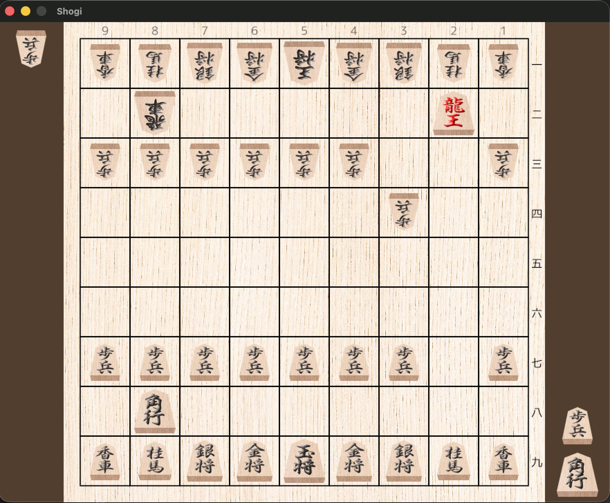

# Shogi (C++ & SFML)

A modern Shogi (Japanese Chess) clone built with C++, CMake, and SFML.
Cross-platform compatible, featuring authentic Shogi rules, drop mechanics, and a built-in match history system.

## Features

- Authentic Shogi gameplay rules
- Full piece set with promotion mechanics
- Piece Drop system
- Visual rendering and smooth input handling via SFML

## Screenshots



## Build & Run

### Requirements
- C++17 compatible compiler (e.g. `g++`, `clang`, MSVC)
- [CMake](https://cmake.org/) (>= 3.10)
- [SFML](https://www.sfml-dev.org/) (>= 3.0)

### Building from Command Line (Linux/macOS/WSL)

```bash
git clone https://github.com/daniel-diestel/shogi-sfml.git
cd shogi-sfml
mkdir build && cd build
cmake ..
make
./shogi
```

## License
This project is licensed under the MIT License – see LICENSE for details.
